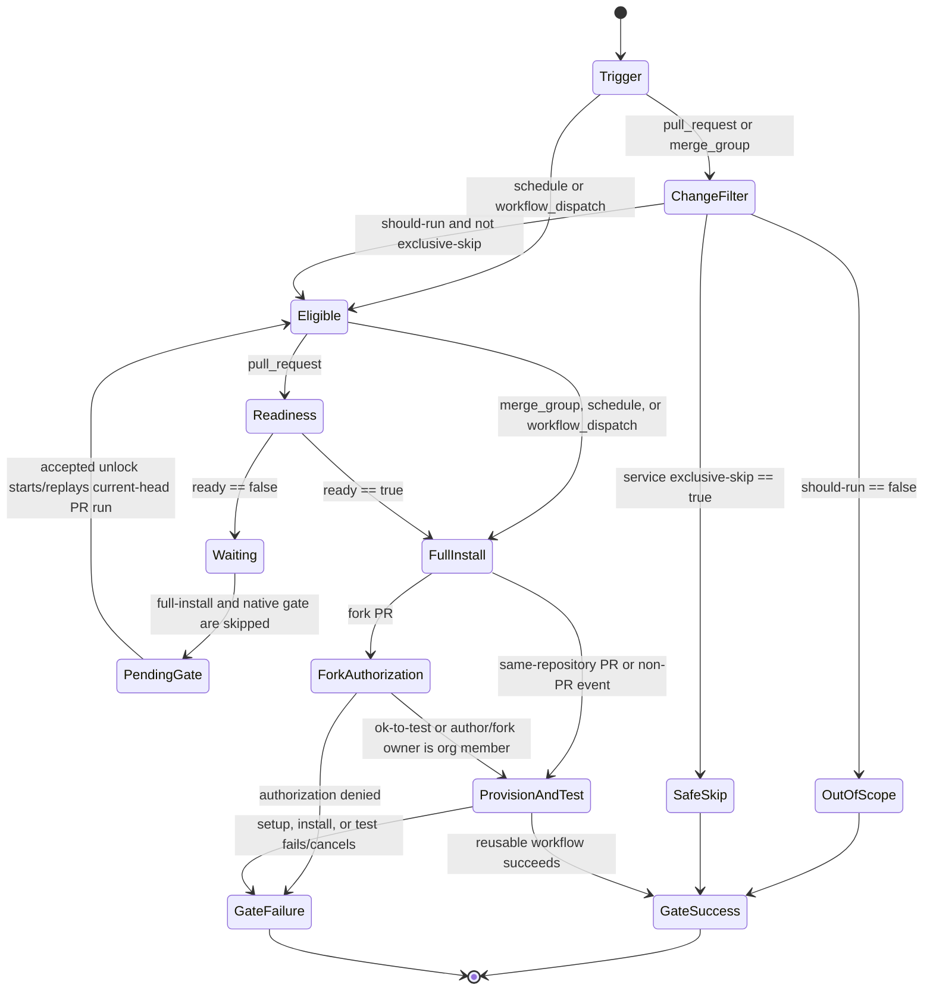
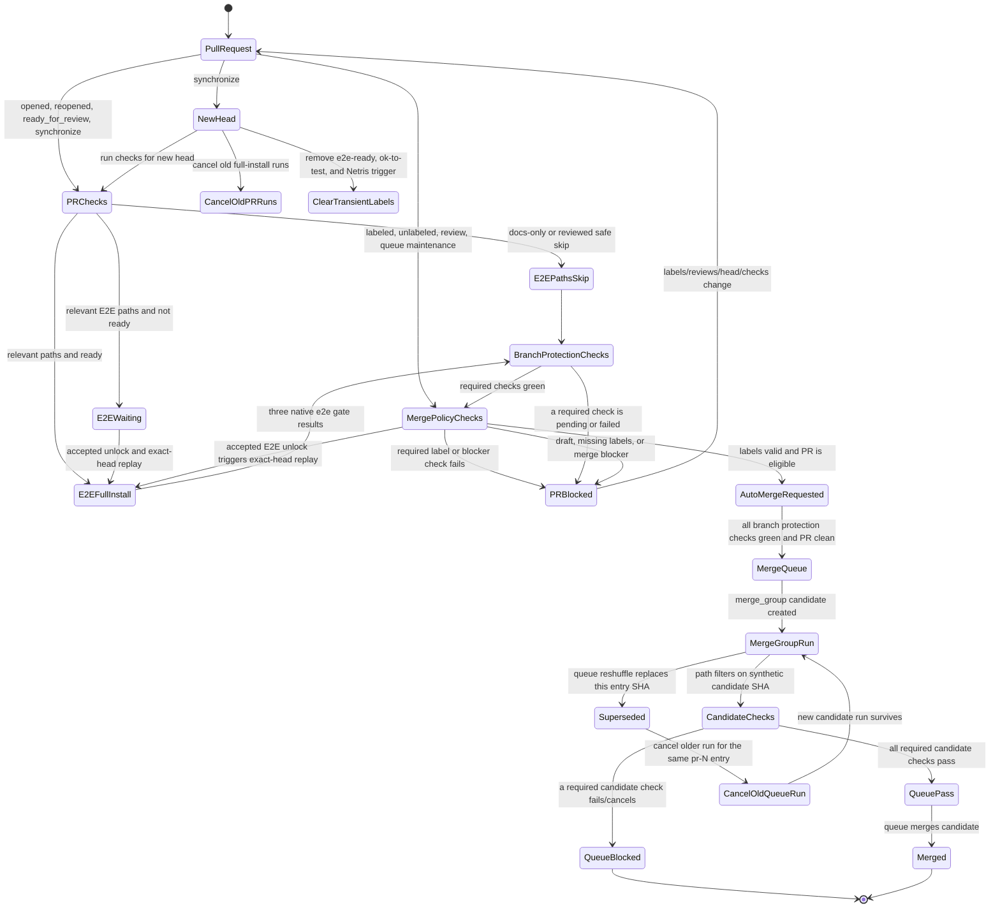
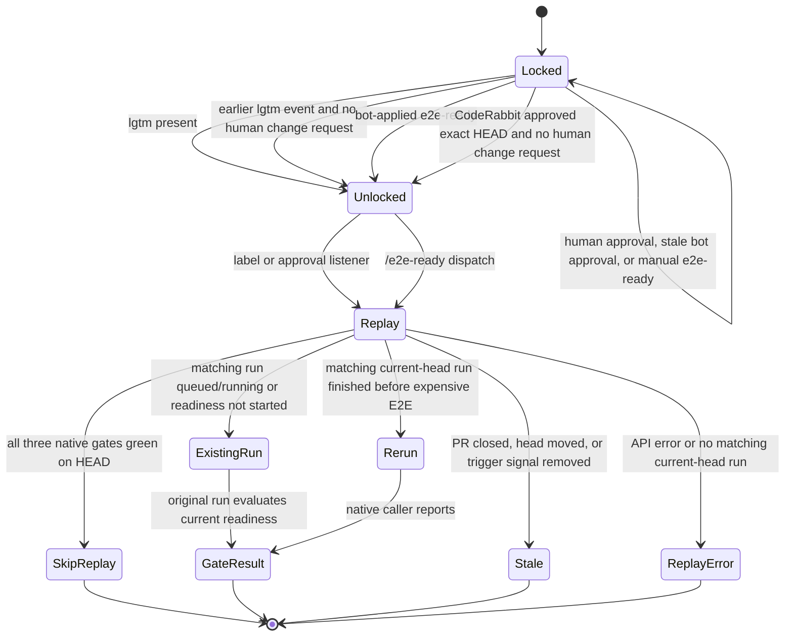
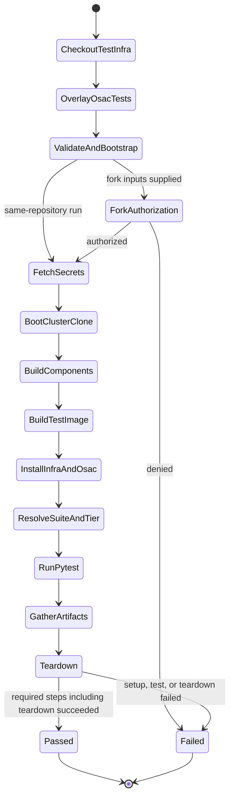
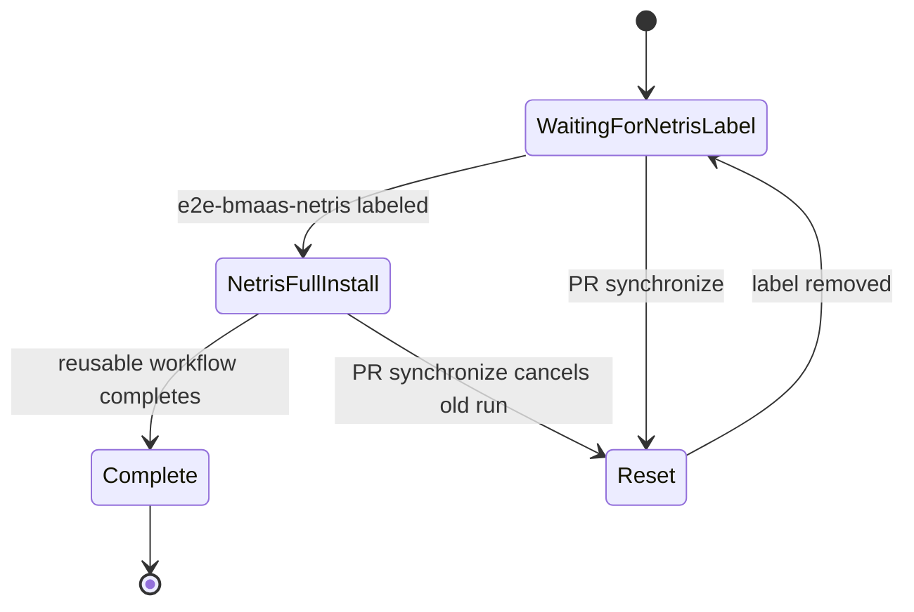

# OSAC E2E CI state machine

This document models the merge-required VMaaS, CaaS, and BMaaS full-install E2E
workflows, their readiness signals, and the separate BMaaS Netris label lane.
The states and guards below are derived from the workflow and action code, not
from a proposed design.

OSAC owns the PR and merge-group caller workflows; those call reusable
full-install workflows in `osac-test-infra`. The test-infra repository also
has caller workflows for its own PR/merge-group/scheduled runs, a snapshot
VMaaS workflow, and a scheduled/manual full-regression workflow. Those are
separate entrypoints and do not report OSAC's three merge-required gate checks.

## Audited source revisions

Audit date: 2026-10-07.

The OSAC checkout was refreshed from `origin/main` before this model was
written. The reusable workflows and actions are called from `osac-test-infra`
using `@main`, so that side is also recorded at the revision read for this
audit. These links pin the evidence even though the live workflow references
remain floating.

| Repository | Revision used for this audit |
|---|---|
| `osac-project/osac` | [`515ce87588967055537a8fd8e7edb0e2d728eb85`](https://github.com/osac-project/osac/tree/515ce87588967055537a8fd8e7edb0e2d728eb85) |
| `osac-project/osac-test-infra` | [`5e821a163e1ceabbb0d5bb5f2cf91e03331fb8d1`](https://github.com/osac-project/osac-test-infra/tree/5e821a163e1ceabbb0d5bb5f2cf91e03331fb8d1) |

## Merge-required full-install flow

Each of the three service workflows has the same top-level control flow. A
`pull_request` change is path-filtered first. A relevant PR then waits at the
cheap readiness job until a cost-unlock signal is accepted. `merge_group`,
schedule, and manual dispatch runs bypass that readiness job. Fork secret
authorization is a separate check inside the reusable test-infra workflow.



`e2e-readiness` returning `ready=false` is a successful inexpensive check; it
does not fail the run. The required `e2e-vmaas-gate`, `e2e-caas-gate`, or
`e2e-bmaas-gate` remains pending until the native caller workflow reports. The
unreadied PR path has a caller job that posts a pending check when GitHub grants
`checks:write`; on fork runs where that permission is unavailable, the absent
required check is still waiting. When `lgtm` or `e2e-ready` is labeled,
`label-gate` calls the gate-invalidation action unless all three gates are
already green. That action posts only when it can bind the check to the PR
head's check suite; otherwise it skips the post. The readiness and unlock
logic still rejects a manually applied `e2e-ready` label unless its latest
label event came from `github-actions[bot]`. The unlock starter does not post
required gate checks: its `/e2e-ready` dispatch runs on `main`, where a check
would be unbound from the PR's check suite. On `synchronize`, cleanup dismisses
orphaned unlock checks; terminal caller runs also complete stale in-progress
checks.

When the paths show a docs-only or reviewed safe-skip change, the required gate
succeeds without running the full install. A filter/API failure or a
failure/cancellation in the full-install job fails the gate.

The three merge-required gate checks must each report success on the PR head.
The unlock path looks for runs at the exact current head and will not treat an
older run as evidence for the current commit. If the exact-head run is queued
or already running, it lets that run evaluate the current signal; if it already
finished without the expensive E2E job, it can rerun that caller. If all three
native gates already succeeded on the head, the starter skips replay.

### Path selection

The `e2e-code` filter ignores documentation, Go/Python unit-test paths,
fixtures, and other reviewed unrelated paths. Since it excludes `tests/**`,
the separate `e2e-suite` filter explicitly includes `tests/e2e/**`. A PR runs a
service workflow when either filter matches, unless that service's reviewed
`*-exclusive-skip` rule proves the changed files safe to skip. The repository
variable `CI_GATING_ENABLED=false` forces the path decision to run; it does
not bypass the readiness requirement for PRs. Schedules and manual dispatches
always run, and merge-group runs do not use the PR readiness gate.

## PR lifecycle and merge queue

The full-install checks are one part of the wider PR merge lifecycle. The
`label-gate` separately requires the Prow labels `lgtm`, `approved`, and
`jira/valid-reference`, and rejects `do-not-merge/hold` and
`do-not-merge/work-in-progress`. The auto-queue logic also blocks
`do-not-merge/invalid-owners-file` and `needs-rebase`, and checks draft state
and mergeability before it enables auto-merge or enqueues a PR. `approved`,
`jira/valid-reference`, and the blocker labels are merge-policy inputs, not
E2E cost-unlock signals. A new `lgtm` unlocks E2E and is also required for
merge eligibility; `/e2e-ready` unlocks E2E but does not replace `lgtm`.



The PR has multiple event listeners, so the `synchronize` cleanup and fresh
`pull_request` run happen as separate workflows; the diagram compresses those
concurrent listeners into one lifecycle.

On `synchronize`, the three ordinary `pull_request` runs use PR-scoped
concurrency with cancellation enabled. A separate `pull_request_target` handler
force-cancels any old full-install runs that are still running on obsolete
SHAs, and removes `e2e-ready` and `ok-to-test`; Prow/auto-queue removes current
`lgtm`. The Netris cleanup removes `e2e-bmaas-netris` and cancels its
PR-scoped run. The historical `lgtm` event remains a readiness signal subject
to the human change-request rule described above. These cleanups make
readiness, fork authorization, and run status reflect the new head.

When the PR enters GitHub's merge queue, each full-install caller receives a
`merge_group` event. It path-filters the synthetic queue candidate, skips the
PR readiness and fork-authorization inputs, and runs the normal full install
when E2E-relevant paths changed. The checks therefore validate the candidate
commit GitHub proposes to merge, not only the PR head. The `label-gate` auto
passes its merge-group job because labels were checked on the PR. Queue entries
can run speculatively in parallel, so each merge-group workflow uses a unique
run-id concurrency group; a dedicated job cancels only an older run for the
same `pr-N` queue entry after a reshuffle. Successful required candidate
checks let GitHub merge the candidate; a failed or cancelled required check
keeps that candidate from passing.

The auto-queue workflow acts on collaborator PRs. With `lgtm` present it
dismisses outstanding `CHANGES_REQUESTED` reviews, then enables auto-merge when
the PR is not draft and the required labels/blockers are valid. Once branch
protection checks are green and GitHub reports the PR mergeable and clean, the
maintainer job explicitly enqueues it. This merge-policy behavior is separate
from the readiness action's review calculation.

## Readiness decision

For a PR, the infra action fetches the current labels, reviews, and issue events
from GitHub. Its decision order is:

1. Current `lgtm` label: allow.
2. A historical `lgtm` label event: allow unless a human reviewer still has a
   latest `CHANGES_REQUESTED` decision.
3. Current `e2e-ready` label: allow only when its latest label event was
   applied by `github-actions[bot]`.
4. Latest `coderabbitai[bot]` review is `APPROVED` on the exact current head
   SHA, and no human reviewer has a latest `CHANGES_REQUESTED` decision: allow.
5. Otherwise: wait (`ready=false`). GitHub API errors fail the readiness job.

The historical `lgtm` check matters because Prow removes that label on pushes.
Current `lgtm` and a trusted current `e2e-ready` label take precedence over an
outstanding human change request. Historical `lgtm` and CodeRabbit approval do
not. A human `APPROVED` review is not a cost-unlock signal.

## E2E-related labels and commands

| Label or command | Cost unlock | Starts or replays E2E | Fork secrets | Staleness/guard |
|---|---:|---|---:|---|
| `lgtm` / `/lgtm` | Yes | Adding the label starts the unlock listener; after pushes, the PR caller re-evaluates readiness. | No | Prow removes the current label on push. A prior label event still unlocks unless a human has an outstanding `CHANGES_REQUESTED`. |
| `approved` | No | None | No | Required by `label-gate` for merge eligibility; distinct from E2E readiness. |
| `jira/valid-reference` | No | None | No | Required by `label-gate` for merge eligibility; distinct from E2E readiness. |
| `/e2e-ready` / `e2e-ready` | Yes, for the current head | The slash handler applies the label and dispatches `e2e-on-label`; GitHub does not start another workflow from the `GITHUB_TOKEN` label event. | No | Only a label event by `github-actions[bot]` is trusted. The label is removed on push. A manual UI label is rejected. |
| CodeRabbit `APPROVED` | Yes, for the exact reviewed head | Same-repository PRs go directly to the unlock starter. Fork PRs hand off to a default-branch `workflow_run` listener which rechecks the approval, then starts replay. | No | A newer bot decision, a different head SHA, or a human's outstanding `CHANGES_REQUESTED` blocks this signal. |
| `/ok-to-test` / `ok-to-test` | No | It can approve GitHub `action_required` runs and rerun failures, but it does not unlock the full-install readiness gate. | Yes | For a fork, the full-install reusable checks this label or org membership of the PR author/fork owner. The label is removed on push. |
| `/test e2e`, `/retest` | No | Rerun existing PR workflows; readiness is still checked. | No | A rerun does not itself change readiness. |
| `e2e-bmaas-netris` | Separate lane; not one of the three merge-required gates | Starts the BMaaS Netris full-install caller when labeled. `/test e2e-bmaas-netris-full-install` rotates the label to force a new label event. | Fork authorization is handled by its reusable workflow. | The label is removed on push, and the workflow concurrency group cancels the older run. Re-add it to test the new head. |
| `do-not-merge/hold`, `do-not-merge/work-in-progress` | No | None | No | `label-gate` fails while either is present. |
| `do-not-merge/invalid-owners-file`, `needs-rebase` | No | None | No | `auto-queue` blocks auto-merge/enqueue while either is present. |

The slash-command handler requires write access or higher. `/e2e-ready` also
checks that the PR head has not moved since the command was read. The
CodeRabbit fork replay verifies a successful `fork-handoff`, an open fork PR
targeting `main`, the exact current head SHA, and current review state before
starting any run.



## Full-install reusable workflow

Once the OSAC caller is eligible, it calls the matching reusable workflow in
`osac-test-infra`. The reusable checks out test-infra code, then overlays only
the `tests/` tree from the OSAC repository/ref passed by the caller. Component
images and the installer are also resolved from the OSAC PR ref; the component
build logic pins repeated fetches of the same repository to one resolved SHA.



Artifact gathering and cluster teardown run with `if: always()`. On configured
main-branch runs, failure diagnosis/notifications may follow, but they do not
replace the native gate result. PR full-install defaults select the service
suite and the markers wired by its OSAC caller; workflow dispatch defaults to
the service's sanity tier. If a requested `<service>/<tier>` directory has no
`test_*.py` files, the reusable falls back to the service directory to avoid a
zero-test run. The suite markers are declared by `tests/e2e/conftest.py` in
OSAC.

## Separate BMaaS Netris label lane

`e2e-bmaas-netris` is a distinct label-triggered full install. The OSAC
optional-workflow registry maps `/test e2e-bmaas-netris-full-install` to this
label lane; the slash handler verifies that the PR head has not moved, removes
an existing label if needed, then reapplies it with the configured trigger
token. It calls the Netris reusable workflow in test-infra and does not feed
the three regular `e2e-*-gate` checks. A `synchronize` event removes the label
and cancels the PR-scoped run so a new head needs a fresh label.



## Other E2E entrypoints and sidecars

| Entry point | Trigger and effect | Relation to the OSAC PR/merge queue gates |
|---|---|---|
| Test-infra per-service caller workflows | Their own repo's `pull_request`, `merge_group`, schedule, and `workflow_dispatch` events call the reusable full-install workflows. | Independent workflow runs in `osac-test-infra`; OSAC calls the reusable workflow directly from its own caller files. |
| Test-infra VMaaS snapshot run | `e2e-vmaas-caller.yml` is manually dispatched and calls `e2e-vmaas.yml`, which uses the snapshot runner path. | Does not create OSAC `e2e-*-gate` results. |
| Test-infra CaaS/Netris run | `e2e-caas-netris-full-install-caller.yml` is manually dispatched and calls its reusable ephemeral-runner workflow. | Separate manual validation; no OSAC merge-gate result. |
| Test-infra CaaS agentless-network run | `e2e-caas-agentless-net-full-install.yml` is manually dispatched. The workflow provisions an ephemeral runner, executes the `infra/agentless-net` journey, gathers artifacts, and tears down. | Separate manual infrastructure validation; no OSAC merge-gate result or PR label trigger. |
| Test-infra full regression | Daily schedule or manual dispatch runs one `PROFILE=full-ci` install and VMaaS, CaaS, and BMaaS tests. `/test e2e-full-regression` only dispatches it from an `osac-test-infra` PR; the handler explicitly refuses cross-repository dispatch from an OSAC PR. | Separate non-PR validation; it does not unlock or satisfy the OSAC PR gates. |
| Reserve E2E comment slot | OSAC `workflow_run` listener runs on the full-install `requested` event and calls the reusable comment helper. | User-facing comment coordination only; it does not affect gate status. |
| AI E2E failure diagnosis | OSAC `workflow_run` listener calls test-infra after a full-install run completes; diagnosis is enabled for configured main runs. | Post-run diagnostics do not replace the native gate conclusion. |
| Manual stale-gate cleanup | OSAC `complete-stale-e2e-gates.yml` can complete or dismiss stale check runs for a selected SHA and optionally remove `e2e-ready`. | Operational repair only; it does not rerun tests. |

## Code trace and validation

| State/transition | OSAC source | Test-infra source |
|---|---|---|
| Event types, path filters, readiness outputs, pending/success/failure gates | [`e2e-vmaas-full-install.yml`](https://github.com/osac-project/osac/blob/515ce87588967055537a8fd8e7edb0e2d728eb85/.github/workflows/e2e-vmaas-full-install.yml), [`ci-filters.yml`](https://github.com/osac-project/osac/blob/515ce87588967055537a8fd8e7edb0e2d728eb85/.github/filters/ci-filters.yml); same job structure in the CaaS and BMaaS workflows | [`check-e2e-readiness.sh`](https://github.com/osac-project/osac-test-infra/blob/5e821a163e1ceabbb0d5bb5f2cf91e03331fb8d1/.github/actions/check-e2e-readiness/check-e2e-readiness.sh) |
| PR label checks, unlock invalidation, auto-merge eligibility, and queue entry | [`label-gate.yml`](https://github.com/osac-project/osac/blob/515ce87588967055537a8fd8e7edb0e2d728eb85/.github/workflows/label-gate.yml), [`auto-queue.yml`](https://github.com/osac-project/osac/blob/515ce87588967055537a8fd8e7edb0e2d728eb85/.github/workflows/auto-queue.yml), [`auto-queue.sh`](https://github.com/osac-project/osac/blob/515ce87588967055537a8fd8e7edb0e2d728eb85/.github/scripts/auto-queue.sh) | [`invalidate-e2e-gates.sh`](https://github.com/osac-project/osac-test-infra/blob/5e821a163e1ceabbb0d5bb5f2cf91e03331fb8d1/.github/actions/invalidate-e2e-gates/invalidate-e2e-gates.sh) |
| PR-head replacement, stale run cancellation, and stale gate-check cleanup | [`e2e-cancel-stale-runs-on-push.yml`](https://github.com/osac-project/osac/blob/515ce87588967055537a8fd8e7edb0e2d728eb85/.github/workflows/e2e-cancel-stale-runs-on-push.yml), [`cancel-stale-e2e-runs.sh`](https://github.com/osac-project/osac/blob/515ce87588967055537a8fd8e7edb0e2d728eb85/.github/scripts/cancel-stale-e2e-runs.sh) | [`complete-stale-e2e-gates.sh`](https://github.com/osac-project/osac-test-infra/blob/5e821a163e1ceabbb0d5bb5f2cf91e03331fb8d1/.github/actions/complete-stale-e2e-gates/complete-stale-e2e-gates.sh) |
| Merge-group candidate checks and reshuffles | The three suite callers' `merge_group` paths and `cancel-stale-merge-queue` job | Gate status cleanup for terminal reusable runs: [`complete-stale-e2e-gates.sh`](https://github.com/osac-project/osac-test-infra/blob/5e821a163e1ceabbb0d5bb5f2cf91e03331fb8d1/.github/actions/complete-stale-e2e-gates/complete-stale-e2e-gates.sh) |
| `lgtm`, `e2e-ready`, CodeRabbit, and exact-head replay | [`e2e-on-label.yml`](https://github.com/osac-project/osac/blob/515ce87588967055537a8fd8e7edb0e2d728eb85/.github/workflows/e2e-on-label.yml), [`e2e-on-approval.yml`](https://github.com/osac-project/osac/blob/515ce87588967055537a8fd8e7edb0e2d728eb85/.github/workflows/e2e-on-approval.yml), [`e2e-on-approval-fork.yml`](https://github.com/osac-project/osac/blob/515ce87588967055537a8fd8e7edb0e2d728eb85/.github/workflows/e2e-on-approval-fork.yml), [`slash-command.yml`](https://github.com/osac-project/osac/blob/515ce87588967055537a8fd8e7edb0e2d728eb85/.github/workflows/slash-command.yml) | [`e2e-on-label.yml`](https://github.com/osac-project/osac-test-infra/blob/5e821a163e1ceabbb0d5bb5f2cf91e03331fb8d1/.github/workflows/e2e-on-label.yml), [`e2e-start.sh`](https://github.com/osac-project/osac-test-infra/blob/5e821a163e1ceabbb0d5bb5f2cf91e03331fb8d1/.github/actions/e2e-start/e2e-start.sh), [`slash-command-handler.yml`](https://github.com/osac-project/osac-test-infra/blob/5e821a163e1ceabbb0d5bb5f2cf91e03331fb8d1/.github/workflows/slash-command-handler.yml) |
| Fork secrets and stale labels/runs | [`ok-to-test-label-cleanup.yml`](https://github.com/osac-project/osac/blob/515ce87588967055537a8fd8e7edb0e2d728eb85/.github/workflows/ok-to-test-label-cleanup.yml), [`e2e-ready-label-cleanup.yml`](https://github.com/osac-project/osac/blob/515ce87588967055537a8fd8e7edb0e2d728eb85/.github/workflows/e2e-ready-label-cleanup.yml), [`e2e-bmaas-netris-label-cleanup.yml`](https://github.com/osac-project/osac/blob/515ce87588967055537a8fd8e7edb0e2d728eb85/.github/workflows/e2e-bmaas-netris-label-cleanup.yml) | [`authorize-fork-pr`](https://github.com/osac-project/osac-test-infra/blob/5e821a163e1ceabbb0d5bb5f2cf91e03331fb8d1/.github/actions/authorize-fork-pr/action.yml), [`e2e-ready-label-cleanup.yml`](https://github.com/osac-project/osac-test-infra/blob/5e821a163e1ceabbb0d5bb5f2cf91e03331fb8d1/.github/workflows/e2e-ready-label-cleanup.yml), [`complete-stale-e2e-gates.sh`](https://github.com/osac-project/osac-test-infra/blob/5e821a163e1ceabbb0d5bb5f2cf91e03331fb8d1/.github/actions/complete-stale-e2e-gates/complete-stale-e2e-gates.sh) |
| Cluster, image, installer, test, artifact, and teardown lifecycle | [`tests/e2e/conftest.py`](https://github.com/osac-project/osac/blob/515ce87588967055537a8fd8e7edb0e2d728eb85/tests/e2e/conftest.py), service test suites under [`tests/e2e/`](https://github.com/osac-project/osac/tree/515ce87588967055537a8fd8e7edb0e2d728eb85/tests/e2e) | [`e2e-vmaas-full-install.yml`](https://github.com/osac-project/osac-test-infra/blob/5e821a163e1ceabbb0d5bb5f2cf91e03331fb8d1/.github/workflows/e2e-vmaas-full-install.yml), with parallel CaaS and BMaaS full-install workflows |
| Separate Netris trigger | [`optional-workflows.yml`](https://github.com/osac-project/osac/blob/515ce87588967055537a8fd8e7edb0e2d728eb85/.github/optional-workflows.yml), [`e2e-bmaas-netris-full-install-caller.yml`](https://github.com/osac-project/osac/blob/515ce87588967055537a8fd8e7edb0e2d728eb85/.github/workflows/e2e-bmaas-netris-full-install-caller.yml), [`e2e-bmaas-netris-label-cleanup.yml`](https://github.com/osac-project/osac/blob/515ce87588967055537a8fd8e7edb0e2d728eb85/.github/workflows/e2e-bmaas-netris-label-cleanup.yml) | [`slash-command-handler.yml`](https://github.com/osac-project/osac-test-infra/blob/5e821a163e1ceabbb0d5bb5f2cf91e03331fb8d1/.github/workflows/slash-command-handler.yml), [`e2e-bmaas-netris-full-install.yml`](https://github.com/osac-project/osac-test-infra/blob/5e821a163e1ceabbb0d5bb5f2cf91e03331fb8d1/.github/workflows/e2e-bmaas-netris-full-install.yml) |
| Separate snapshot/regression/manual suites and sidecars | OSAC wrappers [`e2e-reserve-comment-on-start.yml`](https://github.com/osac-project/osac/blob/515ce87588967055537a8fd8e7edb0e2d728eb85/.github/workflows/e2e-reserve-comment-on-start.yml), [`ai-diagnostic-e2e.yml`](https://github.com/osac-project/osac/blob/515ce87588967055537a8fd8e7edb0e2d728eb85/.github/workflows/ai-diagnostic-e2e.yml), [`complete-stale-e2e-gates.yml`](https://github.com/osac-project/osac/blob/515ce87588967055537a8fd8e7edb0e2d728eb85/.github/workflows/complete-stale-e2e-gates.yml) | [`e2e-vmaas-caller.yml`](https://github.com/osac-project/osac-test-infra/blob/5e821a163e1ceabbb0d5bb5f2cf91e03331fb8d1/.github/workflows/e2e-vmaas-caller.yml), [`e2e-caas-netris-full-install-caller.yml`](https://github.com/osac-project/osac-test-infra/blob/5e821a163e1ceabbb0d5bb5f2cf91e03331fb8d1/.github/workflows/e2e-caas-netris-full-install-caller.yml), [`e2e-caas-agentless-net-full-install.yml`](https://github.com/osac-project/osac-test-infra/blob/5e821a163e1ceabbb0d5bb5f2cf91e03331fb8d1/.github/workflows/e2e-caas-agentless-net-full-install.yml), [`e2e-full-regression-caller.yml`](https://github.com/osac-project/osac-test-infra/blob/5e821a163e1ceabbb0d5bb5f2cf91e03331fb8d1/.github/workflows/e2e-full-regression-caller.yml), [`e2e-reserve-comment-on-start.yml`](https://github.com/osac-project/osac-test-infra/blob/5e821a163e1ceabbb0d5bb5f2cf91e03331fb8d1/.github/workflows/e2e-reserve-comment-on-start.yml), [`ai-diagnostic-e2e.yml`](https://github.com/osac-project/osac-test-infra/blob/5e821a163e1ceabbb0d5bb5f2cf91e03331fb8d1/.github/workflows/ai-diagnostic-e2e.yml) |

The readiness unit tests in test-infra passed (62 cases), including label
trust, current versus historical `lgtm`, review ordering, stale CodeRabbit
SHAs, and human change-request handling. The gate helper tests passed (11
cases), including detection and completion of stale gate checks. The run
sequence was also traced from the three OSAC callers into the `workflow_call`
reusables and the OSAC test-tree overlay; no test-infra or other repository
files were changed.

Commands run from the audited test-infra checkout root:

```bash
bash .github/actions/check-e2e-readiness/check-e2e-readiness-test.sh
bash .github/actions/invalidate-e2e-gates/e2e-gates-lib-test.sh
```
